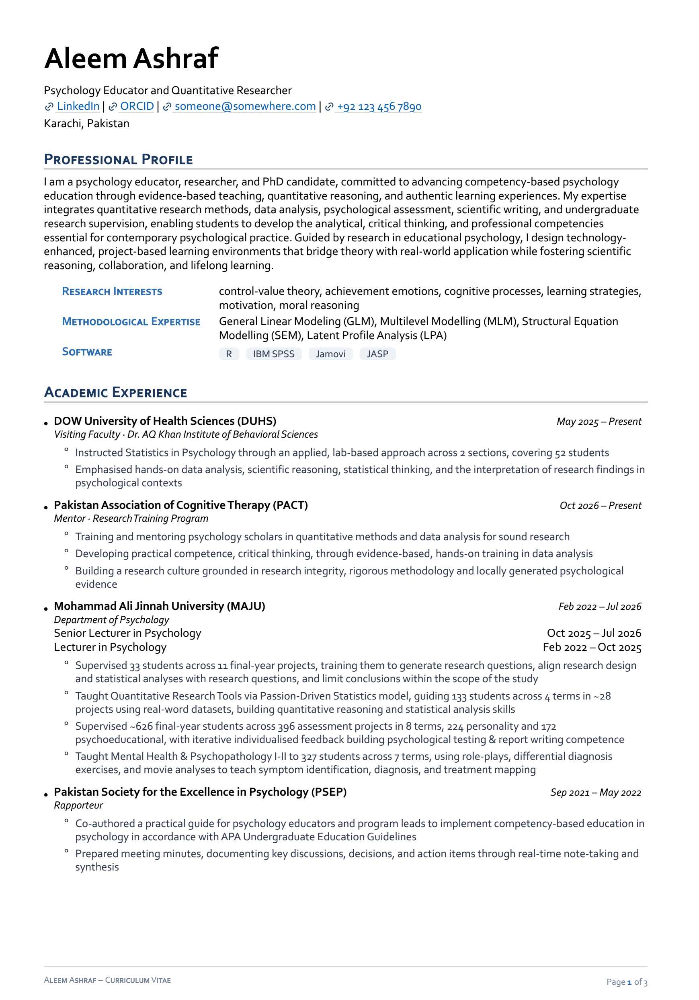

# Reproducible Academic CV

[](https://quarto.org/)
[](https://typst.app/)
[](https://www.r-project.org/)
[](LICENSE)
[]()

A fully reproducible academic CV. **Edit data, not formatting.**

You edit `cv_data.xlsx` and `profile.yml`. R + Quarto + Typst turn them into a publication-ready PDF. No copy-pasting, no broken layout, no reformatting when you add a paper or a course.

Built with the `pro-academic-cv` Typst template.

> This repository contains example data. Replace it with your own data to build your CV. No personal contact details are included.

---

## Why reproducible?

Traditional CVs break every time you update them. This one does not:

- **Single source of truth:** All content lives in Excel + YAML + BibTeX
- **Dynamic counts:** Course counts, student numbers, terms are calculated with Excel formulas, not typed by hand
- **Bullet logic in R:** Long descriptions split on `;` into clean bullets automatically
- **Priority filtering:** Every section has a `priority` column (1-10). Set a threshold in `cv.R` and only the best entries render
- **One command to rebuild:** Re-render and the PDF is ready to send

## Project structure

```
reproducible-cv.Rproj/
├── Aleem Ashraf CV.qmd              # the document: R document that pulls data
├── _quarto.yml         # project + Typst format settings (A4, margins, keep-typ)
├── R/
│   └── cv.R            # the pipeline: readers, filters, formatters, Typst emitters
├── data/
│   ├── profile.yml     # header + profile + interests/methods/software
│   ├── cv_data.xlsx    # 9 sheets of structured CV records (with priorities)
│   └── my_publications.bib  # published + under-review references
├── Aleem Ashraf CV.pdf              # rendered CV (3 pages, A4)
└── Aleem Ashraf CV.typ              # generated Typst source (kept for inspection)
```

## Why reproducible?

Traditional CVs break every time you update them. This one does not:

- **Single source of truth:** All content lives in Excel + YAML + BibTeX
- **Dynamic counts:** Course counts, student numbers, terms are calculated with Excel formulas, not typed by hand
- **Bullet logic in R:** Long descriptions split on `;` into clean bullets automatically
- **Priority filtering:** Every section has a `priority` column (1-10). Set a threshold in `cv.R` and only the best entries render
- **One command to rebuild:** Re-render and the PDF is ready to send

## Preview



